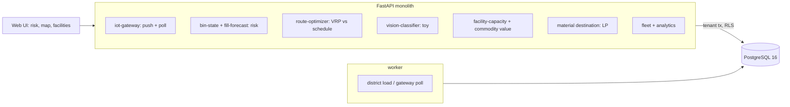

# Autonomous Waste Management & Recycling

For a city's waste operations: it reads smart-bin fill levels, predicts which containers will overflow and when, routes the trucks to
the ones that need it instead of the ones on the schedule, classifies what comes down the recycling line (with a toy that says it is
one), and sends each load to the recovery facility where it is worth most within what the facility can still take.

Built from blueprint 11 of "Advanced Engineering Build Book, Volume III" as a **vertical slice**: the demo scenario end to end,
with the platform parts real and the rest listed under [Not built](#not-built-and-why).

**The district, its containers, readings, trucks, facilities, prices and conveyor frames come from a simulator in this repository.
Streets are a grid, sensors are honest with noise, and the conveyor frames are coloured rectangles. The festival in the demo is
injected by telling the generator; the service sees only readings.**

## Run it

```bash
docker compose up --build        # migrates, seeds, serves http://localhost:8221/ui/ with one worker
docker compose run --rm test     # 10 tests against a throwaway database (about 2 minutes: the VRP runs to its time limit several times)
```

Open http://localhost:8221/ui/ and press **Run all steps** (about 15 seconds), or `make bootstrap demo`.
Demo tokens (local only): `city-ops_manager-demo`, `city-dispatcher-demo`, `city-viewer-demo`. Run `make reset` before a second demo run.

## The demo, step by step

1. Friday 18:00 in an invented district: 500 containers across four streams, 109,026 six-hourly readings and 11,582 pickups from eight weeks under a fixed weekly schedule (3.9% found overflowing), six trucks, five facilities, weekly prices. Each container's fill rate by weekday is estimated from its own readings; back-tested on the last week it is 3.0 points off 24 hours ahead against 5.3 for a constant rate. The response names what the service does not know: a festival starts tonight, and 24 containers are in its zone.
2. The gateway delivers twelve hours of readings (905; six sensors silent) and it is Saturday 06:00. Three readings pushed by hand: one accepted, one from an unregistered sensor and one claiming 140% are refused.
3. Overflow risk: 52 containers have at least a 50% chance of overflowing in 24 hours; the venue's mean risk is 55% against 5% for residential streets. The truth: 54 would overflow if nothing were collected; the list caught 41, flagged 11 that would not, and missed 13, because the festival's containers fill faster than anything in their history.
4. Routes: the policy picks 155 containers; the VRP serves all of them in 5 trips and 125 km (52 litres of fuel) against the fixed Saturday schedule's 217 containers, 7 trips and 202 km (85 litres), one truck over its shift. On the truth, the dynamic plan leaves 4 containers to overflow by Sunday morning; the schedule leaves 12. The fleet view draws it on the district.
5. Twelve conveyor frames: 3 are contamination, 25% of the batch, and the alert fires at 10%. The classifier scores 100% on held-out schematic frames, and the page says that means the frames are easy.
6. Facilities: today's 23.6 t of planned loads are placed by a linear programme. Northgate MRF reaches its 500 kg a day and the rest of the recycling goes on to Riverbend MRF; organics go to the compost plant though the transfer station is closer. The nearest-accepting-facility rule would have sent every load to the transfer station's gate fee: material value −$1,209 against −$2,244, with 9.4 t recovered against none. Applied, the capacity view shows Northgate full.
7. The audit log: load, poll, push, plan, frames, alert, routing, in a hash chain.

## Architecture



| Piece | How it works |
|---|---|
| Simulator (`wr/world.py`) | 500 containers on a 6 km grid by site type and stream, each with a fill rate the fixed schedule was designed for, a weekday pattern (parks and the venue fill on weekends), six-hourly readings with noise and weak batteries, pickups at 08:00 on scheduled weekdays, the festival tripling rates near the venue, weekly price paths, schematic conveyor frames. |
| Fill model | Per container and weekday, the median six-hour increment between consecutive readings with no pickup between; the overall median where a weekday has too few; the spread as the forecast's noise. Projected from the last reading; overflow probability from a normal band. |
| Risk | Expected fill and overflow chance at 8, 24 and 48 hours; stale sensors flagged; the truth beside it: who would really overflow if nothing were collected. |
| Routes | OR-Tools routing: capacitated VRP over the containers the policy picks, one stream per trip, two trips for single-stream trucks and one per stream for the multi-stream truck, four hours a trip, grid distances at 22 km/h and 3 minutes a stop, a dropped container costing 200 km. The fixed schedule run nearest-first beside it; both scored on the no-collection truth. |
| Vision | Colour histograms of a schematic frame into gradient-boosted trees; six classes; a batch alert when contamination passes a share. Labelled a toy wherever it appears. |
| Destinations | A linear programme: each load placed, splits allowed, no facility beyond what it has left today; minimise haul cost less material value (price × recovery yield; the transfer station charges its gate fee). The nearest-accepting rule beside it, its overflow diverted to the transfer station. |
| Platform | Row-level security per operator, Postgres job queue, Idempotency-Key replay, hash-chained audit log, `/metrics`. |

## Data model

`migrations/002_waste.sql` follows the blueprint (containers, fill_readings, vehicles, pickups, sort_observations, facilities,
material_prices); additions are marked `(+)`: districts (seed and clock), sites, plans, deliveries, and on each row what the slice
needs (the simulator's index, the fixed schedule, a plan and sequence on pickups, a batch and model on observations). Points are
x/y kilometres on the grid, not PostGIS geography.

## API

| Method | Endpoint | Purpose |
|---|---|---|
| POST | `/v1/telemetry/fill` | Fill readings, each accepted or refused |
| GET | `/v1/containers/risk` | Overflow risk per container at 8, 24, 48 hours |
| POST | `/v1/routes/optimize` | Today's VRP against the fixed schedule, both scored |
| GET | `/v1/fleet/today` | Each truck's trips and stops |
| POST | `/v1/vision/classify` | Conveyor frames classified; contamination alert |
| GET | `/v1/facilities/capacity` | Capacity, sent today, remaining, prices |
| POST | `/v1/materials/destination` | Loads placed by value less haul within capacity; nearest rule beside |
| POST | `/v1/district:load` · `/v1/telemetry:poll` | (+) 202 + job: load the district; the gateway delivers the next hours |

Contract: [`docs/openapi.json`](docs/openapi.json).

## Measured

[`docs/evaluation.md`](docs/evaluation.md) (`python -m wr.evaluate`, three districts and five weekdays the demo never uses) and
[`docs/performance.md`](docs/performance.md).

| Component | Result | Baseline |
|---|---|---|
| Fill 24 h ahead, error (points) | 3.6–4.0 | constant rate 3.3–3.7: weekday rates did not help on weekdays |
| Overflow list, 24 h | 94–97% recall, 96–99% precision | on weekdays; the festival weekend misses a quarter |
| Kilometres a day | 135–137 | fixed schedule 205–221 |
| Overflows left for tomorrow | 1.8–3.4 | fixed schedule 6.8–8.6 |
| Toy classifier | 100% | majority class 20–22%: the frames are easy |
| Destination value less haul, per six loads | +$445–640 | nearest rule, with its overflow diverted to the gate fee |

Three things these numbers say plainly. The weekday fill rates are no better than a constant rate on weekdays, and only earn their
place where weekends differ; the demo's own back-test, which includes a weekend, has them ahead. Dynamic routing's gain is real and
comes from not visiting containers a third full. And the classifier's perfect score is a property of the pictures, not the method.

## The hardest tradeoff

How much to trust a container's own history. The risk model is each container's past, and the thing the demo is about, a festival,
is exactly the case where the past is wrong. The alternatives were a shared model across containers with site features (which would
have smoothed the venue's rates toward the district's) or an event calendar (which the blueprint lists and this slice does not
have). The model as built sees the festival only through the morning's high readings, so it catches the containers that are already
nearly full and misses the ones that will be by evening; the page shows the 13 it missed rather than hiding them, and the policy's
second rule (expected fill, not just probability) exists because of that miss.

## Threat model (summary)

| Threat | Mitigation here | Gap |
|---|---|---|
| A spoofed or stale sensor reading | Only registered sensors; 0–100; a timezone; nothing from the future; nothing older than the last stored; each reading accepted or refused on its own, and the batch audited | No device authentication |
| A route that breaks a physical rule | Capacity and stream are hard constraints; trip time is capped; the plan reports any truck over its shift | Road closures and traffic are not modelled |
| Material sent where it cannot be taken | Facility capacity is a constraint in the LP and consumed as deliveries are recorded | Capacity is a daily number, not a live gate |
| One operator seeing another's district | Row-level security on every table; tested through the API and directly in the database | |

## Not built, and why

- **Real sensors, a road network, TACO images**: all generated; the grid at a constant speed is the whole road model.
- **A vision model**: colour histograms on schematic frames. A real line needs real frames and labels; the page never pretends otherwise.
- **Time windows and multi-day route planning**: one day, one shift, trips not chained in time (the plan flags a truck whose trips exceed its shift).
- **An event calendar in the fill model**: the blueprint lists it; here the festival is the thing the model has to notice from readings, and the evaluation says how well it does.
- **A mobile app for crews**: the fleet endpoint is the data it would show.
- **Kafka, Redis, OpenTelemetry, Grafana, MLflow, Terraform, CI, SSO, a Next.js front end**: not needed to prove the slice; no cloud account used.

## Commercial sketch

Buyer: municipalities, haulers, recycling facilities, campuses and large sites. Pricing shape from the blueprint: per container per
month, a fleet-optimisation module, facility vision processing, multi-year municipal contracts, sustainability reporting.

## Layout

```
core/        platform kit: db + RLS, jobs, audit chain, HTTP, scenario runner, load test
wr/          world (district, readings, frames), engine (fill rates, risk, VRP, classifier, destinations), api, seed, evaluate
migrations/  forward-only SQL          web/   UI, scenario.json, demo.json (recorded run)
tests/       10 tests                  docs/  evaluation.md, performance.md, openapi.json
```
